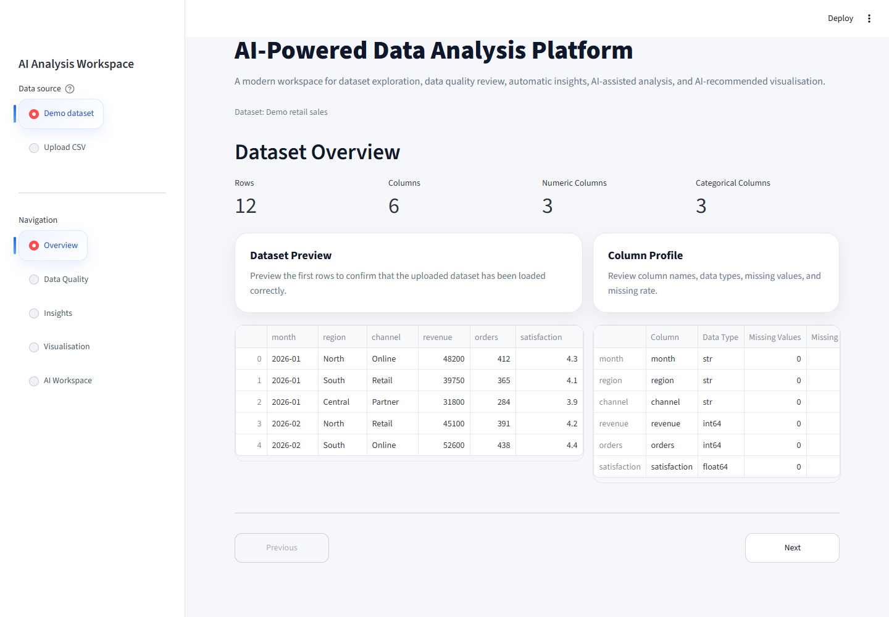
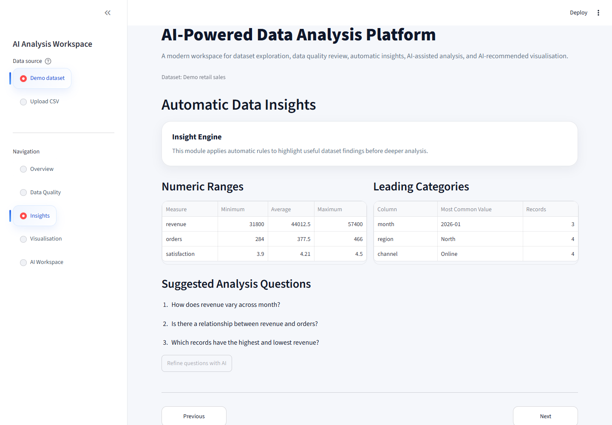

# AI Data Analysis Workspace

[](https://github.com/liyang6620/ai-data-analysis-workspace/actions/workflows/ci.yml)
[](LICENSE)
[](https://www.python.org/)

An AI-assisted Streamlit workspace for exploring CSV datasets, assessing data
quality, generating charts and turning analytical work into a downloadable report.

[Open the live demo](https://ai-data-analysis-workspace-j8qcctkchziuqghezkaxjm.streamlit.app/)

The included retail dataset makes the core workflow immediately testable without
an account, an upload or an OpenAI API key. AI features are optional and only run
after an explicit user action.

## Product Tour

The overview exposes the uploaded schema and its key dimensions immediately.



The insight workspace calculates numeric ranges, leading categories and guided
analysis questions without making an API call.



## Product Workflow

1. Start with the built-in demo or upload a UTF-8 compatible CSV up to 10 MB.
2. Inspect its schema, missing values, duplicate rows and constant columns.
3. Review deterministic local insights and suggested analytical questions.
4. Build distributions, category comparisons and relationship charts locally.
5. Optionally use OpenAI to answer questions, recommend charts and draft a report.

## Key Capabilities

- Content-aware dataset state: changing a file's contents resets stale results even
  when the filename stays the same.
- Guarded ingestion: empty, oversized and malformed CSV inputs receive clear errors.
- Local-first analysis: profiling, quality checks, insights, suggestions and manual
  visualisation do not require a paid API.
- Bounded AI context: only a capped schema summary, category sample and row sample
  are sent to the configured model.
- Constrained chart execution: model output selects from supported chart types,
  aggregations and filters rather than executing generated Python code.
- Raw numeric scatter plots: relationships preserve individual observations instead
  of aggregating or converting the horizontal axis to labels.

## Architecture

```text
CSV upload / demo dataset
          |
          v
  validated data loader -----> content fingerprint
          |
          +-----> local quality checks and deterministic insights
          |
          +-----> manual chart renderer
          |
          `-----> bounded dataset context
                         |
                         v
                 optional OpenAI calls
               answers / chart spec / report
```

The application never evaluates model-generated code. AI chart requests are parsed
as JSON specifications and rendered through the repository's own filtering,
aggregation and Matplotlib functions.

## Technology

- Python 3.11 or 3.12
- Streamlit
- Pandas and NumPy
- Matplotlib
- OpenAI Responses API
- Pytest and Ruff
- GitHub Actions

## Run Locally

```bash
git clone https://github.com/liyang6620/ai-data-analysis-workspace.git
cd ai-data-analysis-workspace
python -m venv .venv
```

Activate the environment:

```powershell
# Windows PowerShell
.\.venv\Scripts\Activate.ps1
```

```bash
# macOS or Linux
source .venv/bin/activate
```

Install and start the app:

```bash
pip install -r requirements.txt
python -m streamlit run app.py
```

The demo dataset and all local analysis features work immediately. To enable the
optional AI tools, copy `.env.example` to `.env` and set:

```env
OPENAI_API_KEY=your_openai_api_key_here
```

For Streamlit Community Cloud, add the same key under **App settings > Secrets**.
The application supports both configuration methods.

## Validation

```bash
pip install -r requirements.txt -r requirements-dev.txt
python -m compileall -q app.py src
ruff check app.py src tests
python -m pytest -q
```

CI runs the same compile, lint and test checks for every pull request and every push
to `main`.

## Project Structure

```text
.
|-- app.py
|-- data/
|   `-- demo_sales.csv
|-- docs/screenshots/
|   |-- insights.png
|   `-- overview.png
|-- src/
|   |-- agent_controller.py
|   |-- chart_generator.py
|   |-- data_loader.py
|   |-- insight_agent.py
|   `-- quality_checks.py
|-- tests/
|   |-- test_analysis.py
|   `-- test_app.py
|-- .github/workflows/ci.yml
|-- CONTRIBUTING.md
|-- SECURITY.md
`-- LICENSE
```

## Privacy and Limits

- Uploaded files remain in the current Streamlit session; this repository does not
  implement a database or persistent dataset storage.
- Local analysis stays inside the app process. When an AI action is requested, a
  bounded summary containing column metadata, statistics, category counts and up to
  five sample rows is sent to OpenAI.
- Do not upload secrets, regulated information or personal data to the public demo.
- CSV parsing is intentionally limited to 10 MB for predictable demo performance.
- AI output can be inaccurate and should be reviewed before operational use.

See [SECURITY.md](SECURITY.md) for private vulnerability reporting and
[CONTRIBUTING.md](CONTRIBUTING.md) for the development workflow.

## License

Released under the [MIT License](LICENSE).
